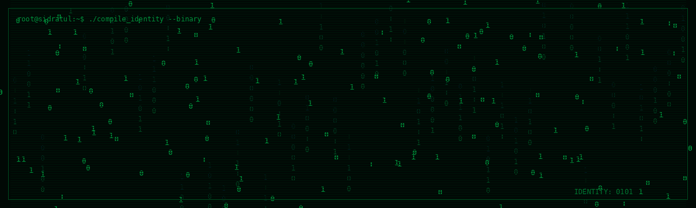

<!-- ========================================= -->
<!--          SIDRATUL - PROFILE README       -->
<!-- ========================================= -->

<!-- BINARY NAME ANIMATION -->
<p align="center">
  
</p>

<!-- TYPING ANIMATION -->
<p align="center">
  
</p>

---

## SYSTEM TERMINAL

```bash
┌──(root㉿sidratul)-[~]
└─$ whoami

Sidratul Moontahar

┌──(root㉿sidratul)-[~]
└─$ cat about.txt

> Computer Science & Engineering Student
> Backend Developer
> Software Engineer
> Technology Enthusiast
> Location: Bangladesh

┌──(root㉿sidratul)-[~]
└─$ ./initialize.sh

[✓] Identity verified
[✓] Development environment loaded
[✓] Technologies detected
[✓] System ready...

┌──(root㉿sidratul)-[~]
└─$ _
```

---

## ABOUT ME

- Currently pursuing BSc in Computer Science & Engineering.
- Interested in Backend Development and Software Engineering.
- Enjoy building practical applications and solving problems.
- Continuously learning and exploring new technologies.
- Based in Bangladesh.

---

## TECHNOLOGIES DETECTED

<p align="center">
  
</p>

<p align="center">
  
</p>

---

## SYSTEM ACTIVITY

<p align="center">
  
</p>

<p align="center">
  
</p>

---

## CONTRIBUTION TRACKER

<p align="center">
  
</p>

---

## ESTABLISH CONNECTION

<p align="center">
  <a href="https://github.com/sidratulmoontahar45-hue">
    
  </a>

  <a href="https://www.linkedin.com/in/mohammad-sidratul-moontahar-177679299/">
    
  </a>

  <a href="https://www.instagram.com/sidratul.islam/">
    
  </a>
</p>

---

<p align="center">
  
</p>

<p align="center">
  <b>ACCESS GRANTED</b>
  <br/>
  <code>root@sidratul:~$ keep_building --forever</code>
</p>
