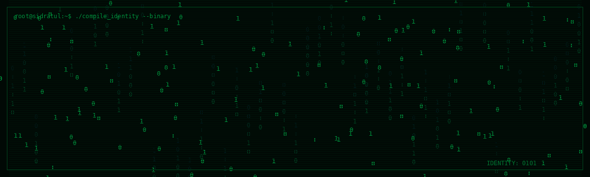

<!-- ========================================= -->
<!--       SIDRATUL - HACKER PROFILE           -->
<!-- ========================================= -->

<!-- BINARY NAME INTRO -->
<p align="center">
  
</p>

<!-- TYPING ANIMATION -->
<p align="center">
  
</p>

<!-- TERMINAL -->
---

## 💻 SYSTEM TERMINAL

```bash
┌──(root㉿sidratul)-[~]
└─$ whoami

Sidratul Moontahar

┌──(root㉿sidratul)-[~]
└─$ cat about.txt

> Computer Science & Engineering Student
> Backend Developer
> Software Engineer
> Technology Enthusiast
> Location: Bangladesh

┌──(root㉿sidratul)-[~]
└─$ ./initialize.sh

[✓] Identity verified
[✓] Development environment loaded
[✓] Technologies detected
[✓] Projects initialized
[✓] System ready...

┌──(root㉿sidratul)-[~]
└─$ _
```

---

<!-- ABOUT -->
##  ABOUT ME

-  Pursuing BSc in Computer Science & Engineering.
-  Interested in Backend Development and Software Engineering.
-  Enjoy building practical applications and solving problems.
-  Continuously learning and exploring new technologies.
-  Bangladesh.

---

<!-- TECH STACK -->
##  TECHNOLOGIES DETECTED

<p align="center">
  
</p>

<p align="center">
  
</p>

---

<!-- PROJECTS -->
##  PROJECT DIRECTORY

```bash
┌──(root㉿sidratul)-[~/projects]
└─$ ls -la

drwxr-xr-x  portfolio/
drwxr-xr-x  interview-preparation-app/
drwxr-xr-x  atm-management-system/
drwxr-xr-x  smart-irrigation-system/
```


<!-- GITHUB STATS -->
## SYSTEM ACTIVITY

<p align="center">
  
</p>

<p align="center">
  
</p>

---

<!-- CONTRIBUTION SNAKE -->
##  CONTRIBUTION TRACKER

<p align="center">
  
</p>

---

<!-- CONNECT -->
##  ESTABLISH CONNECTION

<p align="center">
  <a href="https://github.com/sidratulmoontahar45-hue">
    
  </a>
  <a href="https://www.linkedin.com/in/sidratul-islam/">
    
  </a>
</p>

---

<!-- FOOTER -->
<p align="center">
  
</p>

<p align="center">
  <b>ACCESS GRANTED ✓</b>
  <br/>
  <code>root@sidratul:~$ keep_building --forever</code>
</p>
